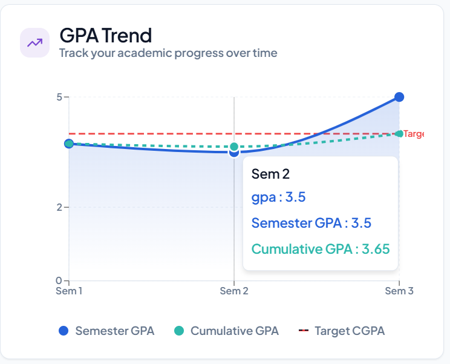
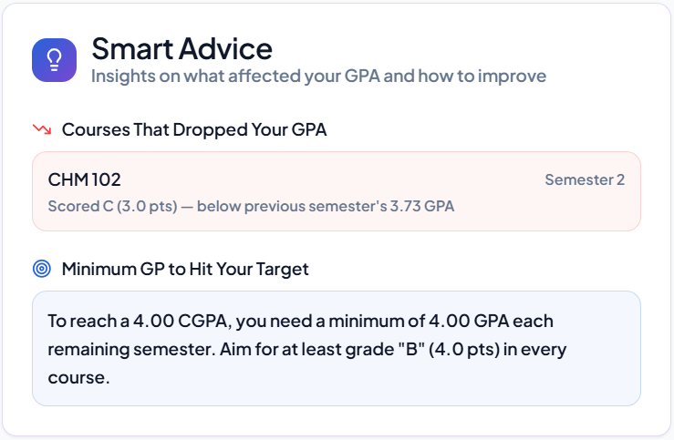
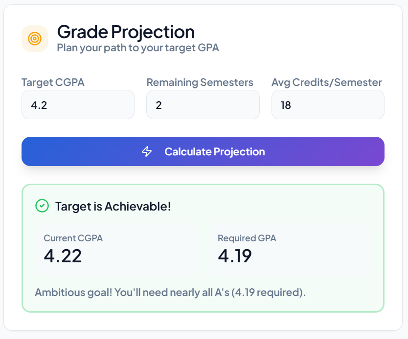
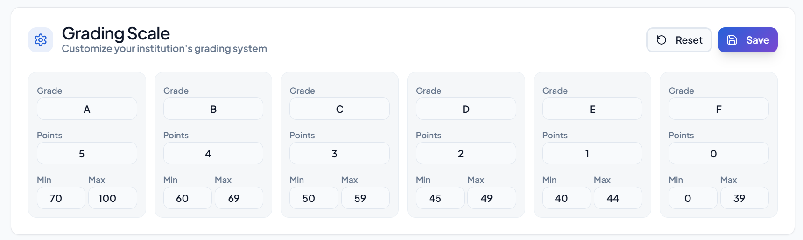

## 🎓💡 Welcome to GPA Genius!
> A smart GPA calculator app designed to empower students to take full control of their education. Beyond simple math, this tool allows you to calculate precise results in seconds, track your progress through intuitive visual dashboards, and crush your academic goals by setting targets that keep you motivated. Whether you are navigating your freshman year or finishing your degree, **GPA Genius** turns your data into a roadmap for success.

## 📝 Description
*GPA Genius* 🔥 is a modern, slick GPA tool built with Lovable.dev — an AI-powered platform that turns ideas into full-stack web apps. The app lets students:
- **Calculate GPA per semester** 📊
- **Track cumulative GPA** across multiple semesters (so you stay on top of your vibe)
- **Visualize academic trends** with graphs (spot where to level up!)
- **Plan and project better outcomes** (get that academic win 🥳)

Designed for *simplicity, accuracy, and ease* — fits students at all levels, from freshmen to grads.

---

## 📁 Project Displays and Screenshots

### 🎥 Demo


**📸 Screenshots**

| *Semester GPA Trends* | *Smart Advice* | *GPA Projection* |
| --- | --- | --- |
|  |  |  |

| Grading Scale Settings |
| --- |
|  |

**Lovable Project URL:**
- [Project](https://lovable.dev/projects/1641c2ea-60df-42bb-80cd-8fd2a9898e58)

---

## 📚 Table of Contents

- [Getting Started](#-getting-started)
- [Repository Structure](#-repository-structure)
- [Editing the Project](#-how-can-i-edit-this-code)
- [Local Setup](#-local-setup)
- [Credits](#-credits)

---

## 🚀 Getting Started

GPA Genius offers flexible editing and management options to fit your style. You can:
- Edit grades and courses directly in the GPA calculator
- Import/export your grading scales to suit your institution
- Use the mobile app for on-the-go tweaks
- Customize settings to match your academic workflow

## 📂 Repository Structure

```text
GPA-Calculator/
├── graphics/                 # Demo animation and app screenshots
│   ├── GPAdemo.gif
│   ├── GPAtrend.png
│   ├── GPAtrend2.png
│   ├── GradeProjection.png
│   ├── GradingScale.png
│   ├── SmartAdvice.png
│   └── SmartAdvice2.png
├── public/                   # Static public assets
│   ├── favicon.ico
│   ├── placeholder.svg
│   └── robots.txt
├── src/
│   ├── components/           # GPA features and reusable UI components
│   │   ├── ui/               # Shared UI primitives
│   │   ├── AdvicePanel.tsx
│   │   ├── GPTrendChart.tsx
│   │   ├── GradingScaleEditor.tsx
│   │   ├── NavLink.tsx
│   │   ├── ProjectionTool.tsx
│   │   ├── SemesterCard.tsx
│   │   └── StatsOverview.tsx
│   ├── hooks/                # Custom React hooks
│   │   ├── use-mobile.tsx
│   │   └── use-toast.ts
│   ├── lib/                  # GPA calculations and utility functions
│   │   ├── gpCalculations.ts
│   │   └── utils.ts
│   ├── pages/                # Application pages
│   │   ├── Index.tsx
│   │   └── NotFound.tsx
│   ├── types/
│   │   └── gp.ts             # GPA-related TypeScript types
│   ├── App.css
│   ├── App.tsx
│   ├── index.css
│   ├── main.tsx
│   └── vite-env.d.ts
├── .gitignore
├── bun.lock
├── bun.lockb
├── components.json
├── eslint.config.js
├── index.html
├── package-lock.json
├── package.json
├── postcss.config.js
├── Semeters.png
├── tailwind.config.ts
├── tsconfig.app.json
├── tsconfig.json
├── tsconfig.node.json
└── vite.config.ts
```

## 📝 How Can I Edit This Code?

### Use Lovable (Recommended)

Visit the Lovable project and start prompting:

- [Project](https://lovable.dev/projects/1641c2ea-60df-42bb-80cd-8fd2a9898e58)

Any changes made using Lovable are automatically committed to this repository.

## 🛠️ Local Setup

```sh
# Clone the repository
git clone https://github.com/MoshoodSO/GPA-Calculator.git

# Navigate into the project directory
cd GPA-Calculator

# Install dependencies
npm install

# Start the development server
npm run dev
```

## 🙌 Credits

Developed by [Shoyombo Moshood O.](https://linkedin.com/in/shoyombo-moshood-582003126/) as a personal project, this tool simplifies GPA calculations and enables users to track their academic goals effectively.

## Contact


- Name: Shoyombo Moshood Olanrewaju
- GitHub: https://github.com/MoshoodSO
- LinkedIn: https://www.linkedin.com/in/shoyombo-moshood-582003126
- Personal site: https://moshoodso.vercel.app/
- Email: shoyombomoshood1@gmail.com
